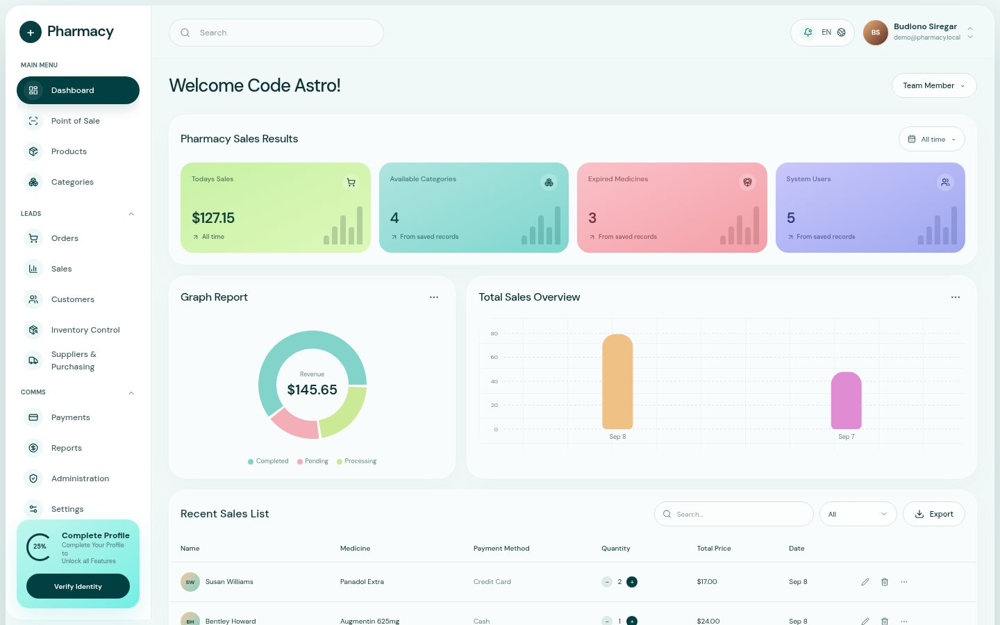
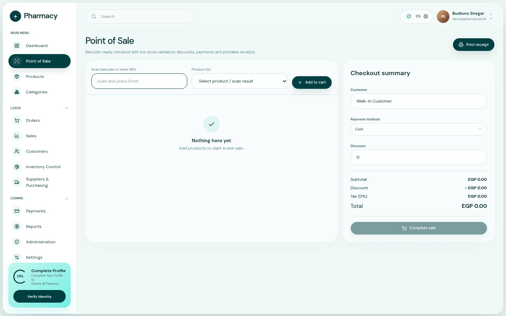
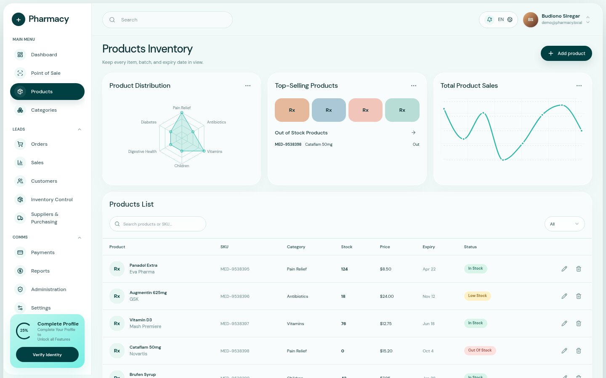
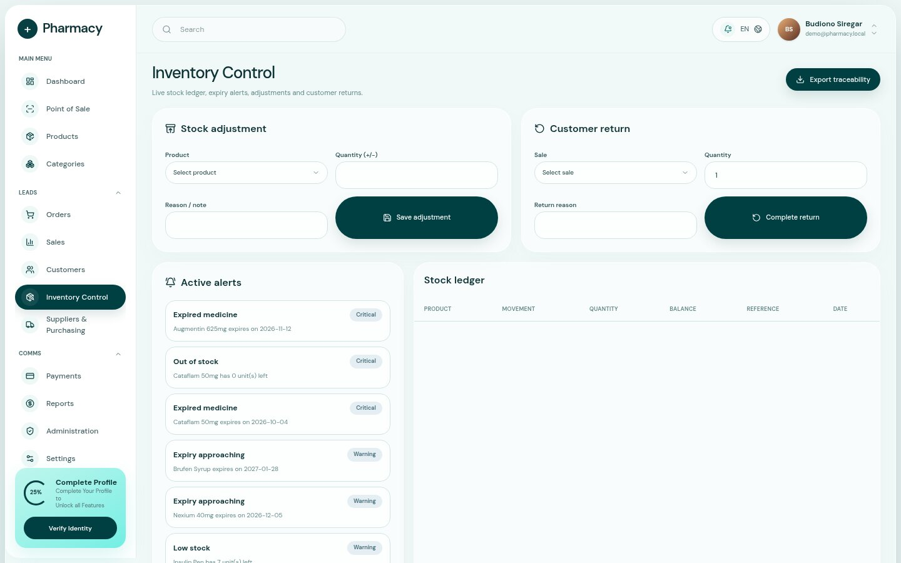
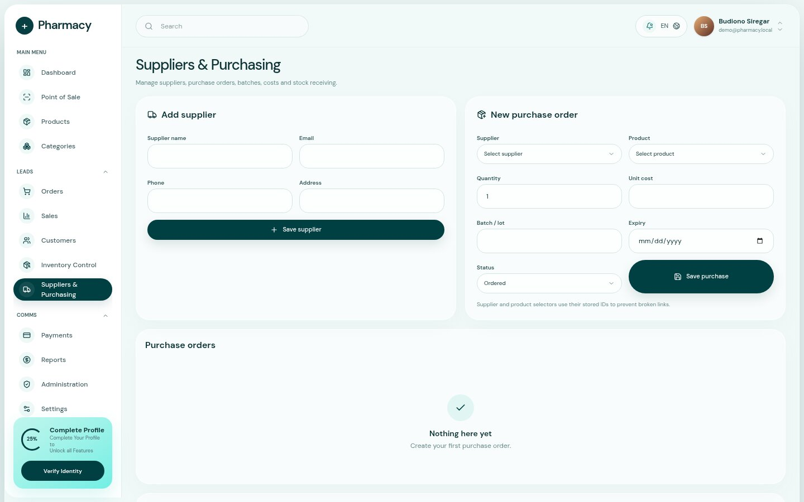
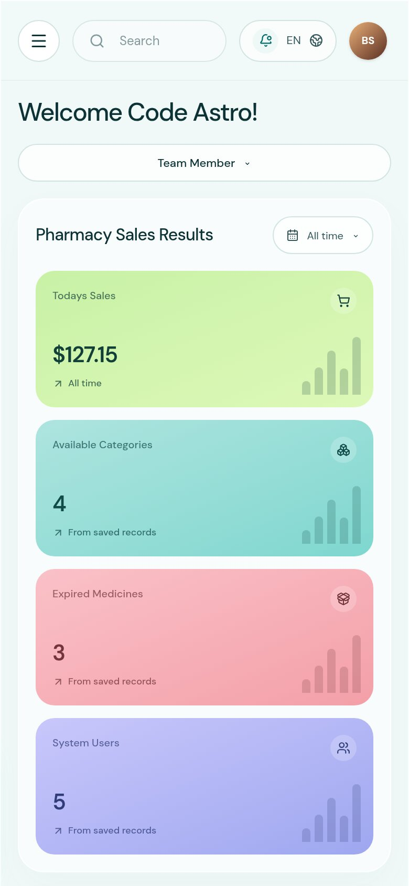
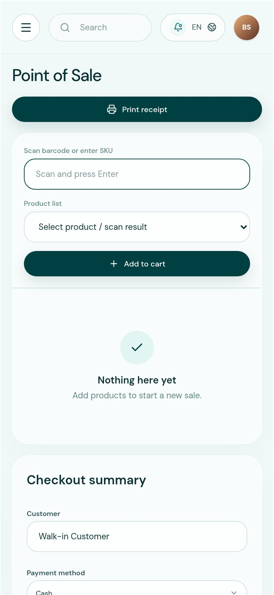

# Pharmacy ERP

A full-stack pharmacy operations system: a React dashboard, an Express API and durable SQLite storage. It runs on a local machine or in Docker, and there is a hosted demo.

**Live demo:** <https://pharmacy-management-system-xi-ochre.vercel.app>

## Project Overview

Pharmacy ERP covers the daily work of a small pharmacy in one app: selling at the counter, tracking stock and expiry, buying from suppliers, keeping customer records, and reporting. The interface is available in English and Arabic and is responsive on desktop, tablet and mobile.

Status: working application with an automated backend test suite. It is a portfolio project. It has not been used in a real pharmacy, and it does not connect to Egypt's EPTTS service (see [External integrations](#external-integrations)).

## Features

- **Point of Sale:** multi-item checkout with discounts, tax, payment recording, printable receipt data and live stock validation.
- **Product catalog:** SKU, barcode/GTIN, batch, expiry, cost, price, unit and reorder level.
- **Inventory:** ledger, stock adjustments, low-stock alerts and expiry alerts.
- **Supply chain:** suppliers, purchase orders, batch receiving, supplier balances and costs.
- **Orders and sales:** orders, sales, payments, refunds and customer returns.
- **Customers:** records with allergies, conditions, prescription references, consent and loyalty.
- **Reports:** reporting with CSV exports and interactive charts.
- **Team and security:** accounts with scrypt password hashing, role-based permissions (Owner, Manager, Pharmacist, Cashier, Inventory, Accountant), persistent HTTP-only sessions, login throttling, security headers and CORS.
- **Operations:** audit trail, and business-data backup export and restore.
- **Languages:** English and Arabic.

## Tech Stack

| Layer | Technology |
| --- | --- |
| Language | TypeScript 5.9, Node.js 22+ |
| Monorepo | pnpm workspaces |
| Frontend | React, Vite, Tailwind CSS, Radix UI, TanStack Query, wouter, Recharts, framer-motion |
| API | Express 5, Zod validation, pino logging |
| API contract | OpenAPI spec with Orval-generated client hooks and Zod schemas |
| Storage | SQLite in WAL mode (better-sqlite3) locally; libSQL / Turso for hosted storage |
| Tests | Node's built-in test runner with tsx |
| Deployment | Docker (multi-stage image), Vercel (serverless API function) |

## Architecture

```
Browser (React SPA, EN/AR)
        |  HTTP  /api/*
        v
Express 5 API  (artifacts/api-server)
  routes: auth, pharmacy, demo, health
  middleware: sessions, role checks, login throttling, CORS, security headers
        |
        v
Storage layer  (src/lib/storage.ts)
  LocalSqliteBackend  -> $PHARMACY_DATA_DIR/pharmacy.sqlite3   (local, Docker)
  LibsqlBackend       -> TURSO_DATABASE_URL                    (hosted demo)
```

```
artifacts/
  pharmacy-erp/    React web app (pages: dashboard, products, POS, supply chain, ...)
  api-server/      Express API, storage backends, integration tests
  mockup-sandbox/  UI mockup playground
lib/
  api-spec/        openapi.yaml, the source of truth for the API
  api-client-react/  generated React Query hooks
  api-zod/         generated Zod validators
  db/              database package
api/index.mjs      Vercel serverless entry for the API
```

- The OpenAPI file drives both the typed client in the web app and the validators in the API.
- The storage layer chooses the backend from the environment. With `TURSO_DATABASE_URL` set it uses libSQL, otherwise a local SQLite file.
- Writes that touch several records run inside transactions, and there are tests for failure cases (`transaction-faults.test.ts`) and for several instances sharing one database (`multi-instance.test.ts`).
- The hosted demo gives each visitor a private sandbox with its own copy of the demo data. Sandboxes expire after 24 hours and are capped in number. The feature is only active when `DEMO_SANDBOX=true`.

## Screenshots

| Dashboard | Point of Sale |
| --- | --- |
|  |  |

| Products | Inventory control |
| --- | --- |
|  |  |

| Suppliers and purchasing |
| --- |
|  |

| Mobile dashboard | Mobile point of sale |
| --- | --- |
|  |  |

Screenshots were taken from the hosted demo.

## Live Demo

<https://pharmacy-management-system-xi-ochre.vercel.app>

Use "Try the demo as admin" on the sign-in page. Each visitor gets a private sandbox with sample data, and nothing you do is visible to others. Sandboxes expire after 24 hours.

The hosted demo runs on Vercel's free tier with libSQL (Turso) storage. It is for evaluation only and has no real pharmacy data. If the demo is busy, wait a few minutes and try again.

## Installation & Setup

Requirements: Node.js 22+ and [pnpm](https://pnpm.io). The repo rejects npm and yarn.

```bash
git clone https://github.com/osama-kamal/pharmacy-management-system.git
cd pharmacy-management-system
pnpm install
pnpm dev
```

This starts the API on <http://localhost:5000> and the web app on <http://localhost:5173>. Without `ADMIN_EMAIL` and `ADMIN_PASSWORD` the first start creates a local evaluation admin. Set both before creating any database you intend to keep.

Quality checks:

```bash
pnpm run typecheck
pnpm test
pnpm run build
```

### Docker

Copy `.env.example` to `.env`, set a long random `ADMIN_PASSWORD`, then run:

```bash
docker compose up --build -d
```

The web app and API are served together at <http://localhost:5000>. Data is kept in the named `pharmacy-data` volume. A fresh production database starts empty unless `SEED_DEMO_DATA=true`.

### Data safety

- Runtime data lives in `PHARMACY_DATA_DIR/pharmacy.sqlite3`.
- Download a backup from Administration before upgrades or bulk imports.
- Passwords and active sessions are stored protected in the database and are not included in downloadable backups.
- Restore needs a valid backup document and an explicit confirmation.
- Database files, local environment files and secrets are excluded from Git and from Docker build contexts.

### External integrations

The project stores GS1-compatible barcode/GTIN, batch, expiry and serial-ready product data. Owner, Manager and Inventory roles can export a traceability CSV from Inventory Control. Connecting that export to Egypt's EPTTS production service still needs licensed credentials and the authority's current exchange contract. No unofficial external API is called.

## Environment Variables

Copy `.env.example` to `.env` for Docker. For local development, set variables in your shell. Variable names only are listed here, never put real values in the repository.

| Variable | Used for | Default / note |
| --- | --- | --- |
| `NODE_ENV` | Runtime mode | `production` in Docker |
| `PORT` | API port | `5000` |
| `PHARMACY_DATA_DIR` | Folder for the SQLite file | `/data` in Docker |
| `FRONTEND_ORIGIN` | Browser origin allowed to call the API when the UI is hosted separately | Leave empty when UI and API share a domain |
| `ADMIN_EMAIL` | Email of the first administrator | Used only when the database has no users |
| `ADMIN_PASSWORD` | Password of the first administrator | Required when `TURSO_DATABASE_URL` is set. Use a long random value |
| `SEED_DEMO_DATA` | Start a fresh database with sample data | `false` |
| `TURSO_DATABASE_URL` | Use hosted libSQL storage instead of a local file | Optional |
| `TURSO_AUTH_TOKEN` | Token for the hosted libSQL database | Only with `TURSO_DATABASE_URL` |
| `DEMO_SANDBOX` | Turn on per-visitor demo sandboxes | `true` only on the hosted demo |
| `DEMO_MAX_SANDBOXES`, `DEMO_THROTTLE_MAX`, `DEMO_IP_LIMIT` | Optional limits for demo sandboxes | Have built-in defaults |
| `LOG_LEVEL` | API log level | Optional |
| `BASE_PATH`, `API_PROXY_TARGET` | Web app hosting path and a non-default API address for the dev server | Optional |

## License

MIT, as declared in `package.json`.
